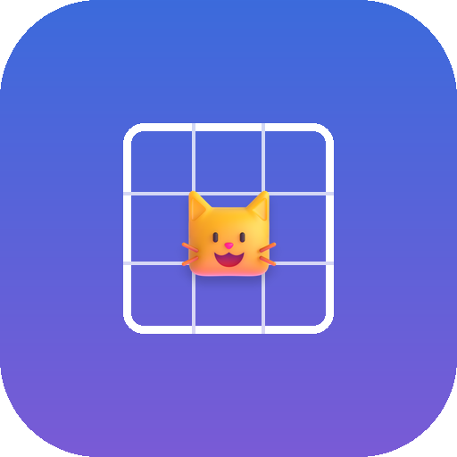

<p align="center"></p>

# GameHub

All your games in one place, with no ads.

An ad-free Android games app with 32 game cards, grouped on one landing page:

- **Sudoku.** Six difficulty levels from Easy to Extreme, notes, smart hints that explain the next move, mistake checking, scoring with row, column and box bonuses, statistics, and light and dark themes with five accent colours. A colourblind mode in Settings adds symbols, outlines and labels across the games wherever colour carries meaning.
- **Meowdoku.** Place one cat in every row, column and colour region, with no two cats touching. 1,000 hand-checked levels from 4×4 to 12×12 that get harder as you go, then endless generated levels.
- **Cosy Cat Sort.** Shelves line both sides of a centre aisle. Pick up the cat nearest the aisle (matching neighbours come too), only place cats next to the same outfit, and gather four on one shelf to send them home. 600 pre-checked levels plus endless levels, Hard levels, boosters and a hint button.
- **Crosswords.** 150 freeform crosswords from quick 7×7 minis to 11×11, with clues written in plain Australian English, an on-screen keyboard, and Letter, Check and Reveal helpers.
- **Word Search.** 32 picture themes (Animals, Ocean, Australia, Space and more). Grids grow from 8×8 to 12×12 and words run across and down, then diagonally, then backwards.
- **2048.** Slide and merge tiles, with undo and a best score.
- **Minesweeper.** Easy, Medium and Hard boards that can always be cleared without guessing; first tap is always safe.
- **Pipeline.** Join matching dots and fill every square, boards from 5×5 to 9×9.
- **Guesswork.** Find the five-letter word in six tries, with a daily word, unlimited practice and statistics.
- **Word Wheel.** Swipe letters on a wheel to fill a crossword, with bonus words that earn hints. 250 levels.
- **Spider Solitaire.** One, two or four suits, with undo and hints.
- **Mahjong Garden.** Mahjong solitaire on six layouts with cartoon tiles; every deal can be cleared.
- **Jigsaw.** Interlocking pieces of 12 cartoon scenes, from 9 to 49 pieces.
- **Sticker Studio.** Peel stickers off the sheet and press them onto numbered outlines to fill 50 cosy isometric scenes, from a living room and a bakery to a moon base and a zoo. Stickers snap onto their outline or stay wherever you drop them, and you can move them later. Tap a placed sticker to swap its style (about 300 stickers have alternatives, such as three kinds of couch) or recolour it. Hints, zoom and an option to hide the numbers.
- **Island Hop.** Join numbered islands with bridges. 320 puzzles from 7×7 to 12×12, each with exactly one solution.
- **Gridlock.** Slide cars and trucks to free the red car. 320 car parks from 3 to 51 moves that climb quickly with easier breathers between, with a target, stars and hints.
- **Crate Mate.** Push every crate onto its spot. 218 original warehouses from one crate to six, each checked by a solver.
- **Potion Pour.** Pour coloured potions between flasks until each holds one colour. 520 solvable levels from 3 to 12 colours.
- **Pressure Point.** One big button and one rule per level: press, don't press, press a set number of times, hold, wait for the right moment, or remember a number for later. A ring of lights is the timer, and one slip ends the run. 60 hand-made levels, then endless new ones that slowly speed up, with a checkpoint every 10 levels.
- **Yeti Games.** Eleven quick one-thumb sports for a yeti and a very brave penguin, in the spirit of the classic web games: Penguin Batting, Orca Splash, Glacier Bounce, Albatross Ride, Flamingo Golf, Big Wave, Stage Dive, Freeride, Jungle Swing, Llama Spit and Icicle Climb. Best scores for each, plus a Grand Tour that plays all eleven in a row. The characters are low-poly 3D models (credited in About) rendered into pictures by tools/yeti.
- **Moto Mania.** Six motorbike games that share one garage: Moto Rush (a 3D endless runner through city streets), Hill Rider (balance up endless hills), Stunt Park (20 stunt tracks with stars), Rush Hour Rider (weave through traffic), Bike Park (60 car-park puzzles) and Delivery Dash (deliver hot food around town). Every game earns coins to buy five bikes with different handling, eight paint colours and four riders. Models are from poly.pizza and Kenney (credited in About), rendered by tools/moto; the runner uses three.js.
- **Arrow Away.** Tap the arrows to send them off the board. Each one slides out the way it points, but only if nothing is in front of it, and a bump costs one of three hearts. Endless levels that grow from 4×5 to big shaped boards, all guaranteed to be clearable, with hints. From level 15, every fourth level is a 3D shape (a corner, channel, cube, open box, steps or roof) that you drag to turn: arrows follow the surface round its edges and leave at an open rim.
- **Land Grab.** Loop out from your land and back to claim everything inside the loop, against nine computer animals. Cross a trail to knock its owner out, but touch the edge or your own trail and you are out. Six maps (Classic, Round, Lake, Cross, Diamond and Rocks), swipe or arrow-key steering, and your best share of each map.
- **Chess.** Play the computer at eight levels from Beginner to Champion (choose White, Black or random), or pass and play with a friend with the board turning after each move. Tap or drag to move, undo, hints, and every rule including castling, en passant, promotion and all draw rules. Pieces are the Cburnett set (BSD licence, credited in About).
- **Sweet Drop.** Cut the ropes to swing a lollipop into a hungry frog's mouth, collecting three stars on the way. 44 levels with bubbles, spikes and hooks, each checked winnable with all three stars by a solver. Art is Kenney CC0.
- **Snip Buddies.** A co-op puzzle game for two: each player is a paper buddy on two legs who can snip pieces off the other. Crouch and stand tall to change height without bending the paper. Fill outlines, pop balloons with a sharp point, roll a ball into place and hold down buttons across 50 levels. Play on two phones over the same wifi or a phone hotspot (no internet needed, host or join by name or address), or both on one phone with a set of buttons each. A bulb shows the shape each buddy needs, and opens by itself when you are stuck. Faces and scenery are Kenney CC0 art.
- **Turtle Bay.** Eight games starring sea turtles and tortoises: Hatchling Dash, Reef Glide, Jelly Snack, Shell Stack, River Hop, Shell Match, Tortoise Trek (30 sliding puzzles, each checked by a solver) and Turtle Race. Best scores for each. Models are from poly.pizza (CC0 and CC-BY, credited in About), rendered by tools/turtle.
- **Marvel Heroes.** An unofficial fan collection of seven games: Web Swing with Spider-Man, Hero HQ (send the right Avenger to each emergency), Power Match (match-3 with each hero's special move), Shield Throw (bank Captain America's shield off walls to stop Ultron's drones), Villain Lockdown (60 sliding-block puzzles), the Infinity Stones quest and a Hero Builder where coins buy masks, capes, emblems and gear. Hero art is drawn by the app on Kenney's CC0 characters; Marvel characters belong to Marvel.
- **Play Together.** Twenty two-player games, on one phone or on two phones over the same wifi, a phone hotspot or Bluetooth (no internet needed). Connect once, then the host picks game after game, with rematches and a running score. Board games: Connect Four, Chess, Draughts, Reversi, Battleships (each phone keeps its fleet secret), Dots and Boxes, Noughts and Crosses, Mancala, Nine Men's Morris, Five in a Row and Memory Duel. Action: Air Hockey, Paddle Ball, Tank Duel, Light Cycles, Sumo Bumpers and Penalty Shootout. Party: Word Duel, Tug of War and Quick Draw (taps judged on the host's clock so lag does not decide it). Pieces, ships, balls and bikes are Kenney and OpenGameArt CC0 images.
- **Casino Night.** Blackjack (split, double, insurance, surrender and a strategy hint), no-limit Texas Hold'em against three computer players with their own styles, roulette, craps, baccarat, Jacks or Better video poker and pokies, all sharing one pile of free play chips with a free top-up whenever you run out. No real money, no purchases, no ads. Cards, chips and dice are Kenney CC0 art.
- **Solitaire.** Classic Klondike with draw one or draw three. Every deal has been proven winnable by a solver. Tap or drag to move, unlimited undo and hints, auto finish, and the bouncing-cards finale.
- **Treat Twist.** A match-3 saga with glossy candies across eight themed worlds and 120 levels. Match four for striped treats, an L or T for wrapped treats and five for a rainbow bomb, and swap specials together for huge combos. Goals include scores, jelly, collecting candies, biscuit blockers, spreading chocolate, liquorice locks and sweets to bring down, with a Treat Party for moves left over. Boosters are earned by playing: no lives, no waiting, no ads. Every level is checked winnable by a bot. Candy art is Melissa Krautheim's CC0 Candy Match 3 set.
- **Block Pounce.** Drag blocks onto an 8×8 board and clear full rows and columns. Combos score big; the game ends when nothing fits.

Games you have not opened yet show a New badge.

No ads, no accounts, no tracking. Progress stays on the phone.

## Install

1. On your Android phone, open the [latest release](https://github.com/nugggy/sudoku-calm/releases/latest).
2. Download the `.apk` file and open it.
3. If Android asks, allow your browser to install apps, then tap **Install**.

Android 8.0 or newer is required.

## Updates

The app checks this repository's Releases for new versions every time it opens, and again when you come back to it after 10 minutes or more (only if **Settings > Updates** allows it). When there is one, it offers to download and install it. You can also tap **Check for updates now** in Settings.

There are two channels:

- **Stable** gets normal releases.
- **Beta** also gets pre-releases.

## Publishing a new version

Requirements: Node.js, the Android SDK, JDK 17, the GitHub CLI logged in as the repository owner, and the signing key (see below).

```
node tools/release.mjs 1.1.0 --notes "What changed"
node tools/release.mjs 1.2.0-beta.1 --beta --notes "Trying something new"
node tools/release.mjs 1.1.0 --dry-run
```

The script bumps the version, runs the tests, builds a signed APK, tags the commit and creates the GitHub release. Phones pick it up from there.

### Signing key

Updates only install over the existing app if every release is signed with the same key. The key lives in `keystore/` and its password in `android/keystore.properties`. Both are excluded from Git on purpose. **Back them up somewhere safe.** If they are lost, future versions cannot update the installed app, and everyone would need to uninstall and reinstall (losing progress).

## Building and testing locally

```
node tools/test-sudoku.mjs              # Sudoku generator, grader and hints
node tools/test-sort.mjs                # Cat Sort level generator
node tools/test-landgrab.mjs            # Land Grab rules, maps and bot games
node tools/gen-meow-levels.mjs          # rebuild the Meowdoku level set
node tools/gen-sort-levels.mjs 600      # rebuild the Cat Sort level set
node tools/gen-solitaire-deals.mjs 500  # find winnable Solitaire deals
node tools/gen-crosswords.mjs 150       # build crosswords from tools/crossword-bank.txt
python tools/build_words.py <scowl>/final # build the word lists from SCOWL
node tools/gen-wordwheel.mjs 250        # build Word Wheel levels
node tools/gen-hashi.mjs                # Island Hop puzzles
node tools/gen-gridlock.mjs             # Gridlock car parks
node tools/gen-crate.mjs                # Crate Mate warehouses
node tools/gen-potion.mjs               # Potion Pour levels
node tools/gen-art.mjs && node tools/gen-scene-art.mjs # redraw the SVG artwork
node tools/sticker/server.mjs <kenney-kits> # render Sticker Studio scenes (open the printed address in Chrome)
cd android && ./gradlew assembleRelease # build the APK
```

The game itself is plain HTML, CSS and JavaScript in `www/`. You can also open it in a desktop browser by serving that folder (for example `python -m http.server` inside `www`).

## Project layout

```
www/                 the game (bundled into the APK as assets)
  js/sudoku-engine.js  generator, solver, difficulty grading, hints
  js/meow-engine.js    Meowdoku generator, logic solver, hints
  js/sort-engine.js    Cat Sort levels and rules
  levels/              pre-built Meowdoku levels
android/             native Android shell (WebView, updates, vibration)
tools/               tests, level generator and release script
```

## Credits

- Word lists: based on SCOWL, copyright Kevin Atkinson and contributors, used under its permissive licence. See `www/levels/WORDLIST-LICENSE.txt`.

- Animal, scenery, vehicle, warehouse and island pictures: [Kenney](https://kenney.nl), CC0 (public domain). See `www/img/kenney/LICENSE-CC0.txt`.
- Sticker Studio scenes are rendered from Kenney's CC0 3D kits (furniture, food, nature, holiday, cube pets, fantasy town, pirate, space, cars, graveyard, castle, trains, survival, mini market, coaster, minigolf, toy cars, mini arcade, mini characters, mini dungeon, platformer, suburban city and mini skate). See `www/img/stickers/LICENSE.txt`.
- All other illustrations (cats, Mahjong tiles, icons, candies and scene objects) are original SVG drawings made for this app.

GameHub is an independent project. It is not made by, endorsed by or affiliated with Easybrain, Oakever Games, Easetouch, King, Hungry Studio or any other game maker. Its games are original takes on popular puzzle styles.
